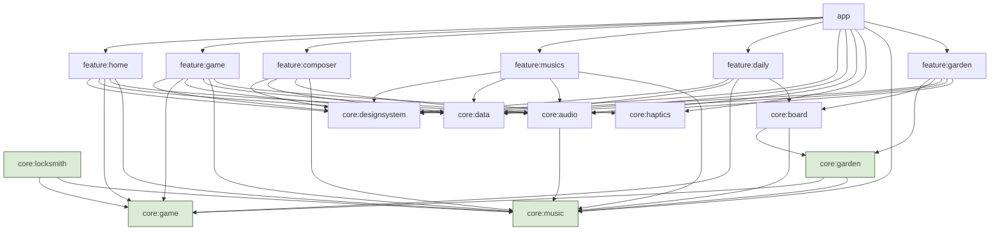

# Architecture

BloX suit les [recommandations d'architecture Android](https://developer.android.com/topic/architecture)
(couches UI, domaine, données ; flux de données unidirectionnel) et le
[guide de modularisation](https://developer.android.com/topic/modularization)
(modules `app`, `core:*`, `feature:*`, plugins de convention). La taille reste
volontairement modeste : un module n'existe que s'il porte une responsabilité claire.

## Modules

Les modules en vert sont en **Kotlin pur** (aucune dépendance Android). Le graphe montre la
cible : une flèche n'est déclarée dans Gradle que lorsque du code l'exige, car `buildHealth`
(plugin d'analyse de dépendances, tâche P0.9) refuse une dépendance sans usage.

| Module | Type | Responsabilité |
|---|---|---|
| `app` | Application Android | Point d'entrée : `MainActivity`, pile de navigation (`BloxNavDisplay`), assemblage des dépendances. |
| `feature:cartridges` | Feature | Choix du jeu (P5.72, ADR 0022) : `CartridgesRoute`, racine de la pile ; une cartouche par jeu (`Cartridge`, Classique seule aujourd'hui). Ne dépend que de `core:designsystem`. |
| `feature:home` | Feature | Écran d'accueil : mode, thème, niveau de départ, musique. |
| `feature:game` | Feature | Écran de jeu, pause et fin de partie. Boucle de jeu, commandes ; le rendu du plateau vient de `core:board`. Prévu : variantes Graine du jour et Au tempo de `GameRoute`, direction musicale (`MusicDirection`) de la Musique vivante (P8, P9, P11, ADR 0026). |
| `feature:composer` | Feature | Éditeur de musique : grille d'une mesure, gestes, écoute, enregistrement (P4.19). |
| `feature:musics` | Feature | Liste « Mes musiques » : écoute, musique des parties, renommer, supprimer avec annulation (P4.22c). |
| `feature:daily` | Feature | Écran d'entrée de la Graine du jour (V38, P9.5, amendement de l'ADR 0002), toujours en thème Couleurs : clé `DailyRoute`, `DailyViewModel` et sa fabrique ; résultats du jour, 7 premières pièces de la graine, Jouer, Copier mon score. La partie elle-même est la variante `Daily` de `feature:game`. |
| `feature:locksmith` | Feature | Écran du Serrurier, second jeu (ADR 0025), toujours en thème Couleurs : clé `LocksmithRoute(level)` (serrure `Padlock.ofLevel(level)`, la même pour tous), `LocksmithViewModel` qui joue la partie de `core:locksmith` ; serrure, pièces, accords et indice à l'écran à venir (P7.12 à P7.14). Écran « Serrures » (P7.35) : clé `PadlocksRoute(current)`, `PadlocksViewModel` et sa fabrique ; résumé, Reprendre et grille des serrures par palier (`PadlockTier` de `core:locksmith`), lus sur l'avancement de `core:data`. Le disque « Serrures » de la barre du Serrurier l'ouvre (P7.36) ; la navigation est assemblée dans `app`. |
| `feature:garden` | Feature | (squelette P10.9, ADR 0027) Écran du Jardin musical ([règles](jardin-musical.md)), toujours en thème Couleurs : clé `GardenRoute`, `GardenViewModel` et sa fabrique ; grille, bac, ambiances, écoute en boucle, jardin gardé. |
| `core:game` | Kotlin pur | **Domaine** : règles et moteur du jeu. Le cœur du projet, développé en TDD. Prévus : le générateur stable `StableRandom` (P1.20, ADR 0026) et le paquet `tempo` d'Au tempo (P11, ADR 0028). |
| `core:locksmith` | Kotlin pur | Domaine du Serrurier ([règles](regles-serrurier.md), ADR 0025) : la serrure (`Padlock`), sa génération (`PadlockGenerator`), la partie (`PadlockGame`), l'indice (`PadlockSolver`) et les accords (`PadlockChords`). Les pièces sont des `Piece` de `core:game`, les accords des `Progression` de `core:music` : avec `core:garden` (prévu), l'un des deux modules du domaine qui dépendent de ces deux-là. |
| `core:garden` | Kotlin pur | Domaine du Jardin musical (P10.4, ADR 0027 ; `Garden` fait, le reste à venir) ([règles](jardin-musical.md)) : le jardin immuable (`Garden`), les ambiances (`GardenMood`), la partition (`Garden.toScore`) et le dé (`GardenComposer`). `api(core:game)` et `api(core:music)`, comme `core:locksmith`. |
| `core:music` | Kotlin pur | Modèle musical : partitions, notes, tempo, effets sonores (`SoundEffect`, P4.8). Pure donnée. |
| `core:audio` | Bibliothèque Android | Séquenceur chiptune (`AudioTrack`), lecture d'un fichier personnel, effets sonores (`SoundEffectPlayer`, pistes statiques, P4.8). |
| `core:haptics` | Bibliothèque Android | Vibrations (`Haptics`, `SystemHaptics` sur `Vibrator`) : un autre service et une autre permission que la musique, un réglage à part (P5.2). |
| `core:data` | Bibliothèque Android | Préférences et records (DataStore). Les noms proposés aux musiques (P4.27) y sont des constantes en français, données du jeu : l'application n'est qu'en français. |
| `core:designsystem` | Bibliothèque Compose | Thèmes BloX (jetons de couleur, typographie), composants partagés. Le thème choisi (`BloxThemeKind`) et le mode sombre du système donnent la variante dessinée, `BloxTheme.variant` (Original, Couleurs jour, Couleurs nuit, ADR 0020) ; les palettes Couleurs reprennent `docs/design-system/tokens.json`, comparé au code par un test (plugin `blox.design.tokens`, ADR 0019). |
| `core:board` | Bibliothèque Compose | Rendu du plateau partagé (ADR 0023) ; tuile d'un bac de pièces `tile/PieceTile` et ses cases `piece/PieceCells` (Serrurier, Jardin musical, P10.2) : styles de case par `PieceType`, géométrie, peintres, pièce suivante, description TalkBack. Lecture TalkBack des accords (`chordTellingOf`, P10.19). Miniature d’N jardin (`garden/GardenThumbnail`, P10.31). Dépend de `core:game`, `core:music`, `core:garden` et `core:designsystem`. |
| `benchmark` | Test Android (`com.android.test`) | Mesures Macrobenchmark (démarrage à froid, images d'une partie et d'une serrure) et génération du profil de référence de `app` (P5.17, P7.21). Hors du graphe : il cible `app` sans en dépendre au sens de Gradle. |
| `build-logic` | Build inclus | Plugins de convention Gradle : la configuration n'est écrite qu'une fois. |

**Profil de référence.** `app` embarque un profil de référence généré par `:benchmark`
(`app/src/main/generated/baselineProfiles/baseline-prof.txt`, versionné) et
`profileinstaller`. Les types de build de mesure (`nonMinifiedRelease`, `benchmarkRelease`)
installent `ch.magori.blox.perf`, pour ne pas effacer l'application installée. Le parcours
mesuré repère ses éléments par des `testTag` exposés comme identifiants de ressource, pas par
leur texte (Serrurier : `LocksmithTestTags`, une case repérée par ce qu'elle montre, la serrure étant tirée
au hasard). Commandes dans `CLAUDE.md` ; à régénérer quand le parcours ou l'écran de jeu
changent beaucoup.

### Règles de dépendance

1. **Une feature ne dépend jamais d'une autre feature.** La navigation entre features est
   assemblée dans `app`, qui seul les connaît toutes. Chaque feature définit sa clé `NavKey` et
   expose une extension d'`EntryProviderScope` qui déclare son entrée ; `app` possède la pile et
   l'affiche avec `NavDisplay` (Navigation 3, [ADR 0011](adr/0011-navigation-3.md)). La pile part des
   cartouches (`CartridgesRoute`) ; la cartouche Classique empile l'accueil, et le disque « Changer de jeu » de
   l'accueil revient aux cartouches par `changeGame` (fonction pure de `app` : dépile jusqu'à elles, ou les met à
   la racine d'une pile restaurée qui ne les a pas). Le retour système sur les cartouches quitte l'application.
   Les touchers des cartouches passent par `CartridgeOpener` (`app`, P7.34) : chaque cartouche empile son écran
   tout de suite, sauf le Serrurier, qui attend la frontière (première serrure non ouverte) lue par
   `PadlockFrontier` (`app`, lecture de l'avancement dès le démarrage, `current: StateFlow<Int?>` et `await()`) ;
   un toucher sur une autre cartouche annule cette attente. `feature:cartridges` ne reçoit que
   `padlockFrontier: StateFlow<Int?>`, pour la sous-ligne « Serrure N ».
   Dans le Serrurier, les fonctions pures de `app` (`NextPadlock.kt`) changent le haut de la pile, et rien si la clé
   attendue n'y est plus (un second toucher) : `nextPadlock` et `resumePadlocks` mettent une serrure à la place de
   la serrure ouverte (P7.30, P7.33) ; `openPadlocks` empile l'écran « Serrures » par-dessus la serrure, qui reste
   dessous avec son ViewModel (P7.36) ; `choosePadlock` retire la liste et met la serrure choisie à la place de celle
   d'en dessous, garde la même clé si c'est celle d'où l'on vient, ou la met à la place de la liste s'il n'y a pas de serrure dessous (P7.36).
   Le parcours mesuré (`BloxJourney`) passe par `cartridge_classic`.
2. **`core:game` et `core:music` ne dépendent de rien.** Ajouter une dépendance à ces modules
   demande un ADR.
3. **Le domaine ne connaît ni couleur, ni son, ni temps réel.** Un thème, un effet sonore,
   une horloge sont des détails de l'application.
4. **`core:designsystem` ne dépend pas du domaine.** L'association « type de pièce → style de
   cellule » vit dans `core:board` (ADR 0023).

## Couches dans une feature

Le schéma recommandé par Android, appliqué à l'écran de jeu :

- **UI (Compose)** : sans logique de jeu. Elle affiche un `GameUiState` et remonte des actions
  (`MoveLeft`, `RotateClockwise`…).
- **ViewModel** : traduit les actions en `Input` du domaine, appelle le moteur, convertit le
  `GameState` en `GameUiState`, réagit aux événements (record, musique qui accélère).
- **Domaine (`core:game`)** : joue le rôle de la couche domaine. Il n'y a pas de module
  `core:domain` séparé avec des use cases : ici le moteur *est* le domaine, et une couche de
  use cases qui ne ferait que déléguer serait de la cérémonie.
- **Données (`core:data`)** : repositories exposant des `Flow`. Un fichier DataStore par sujet,
  créé une seule fois par l'`AppContainer` avec la fabrique de `core:data` (stockage Okio,
  fichier corrompu remplacé par des préférences vides, erreur de lecture lue comme vide) : le
  record (`RECORDS_FILE`) est séparé des préférences (`SETTINGS_FILE`), pour qu'une remise à
  zéro des réglages ne le perde pas ; les deux passent par `preferencesDataStore(scope, file)`.
  Les préférences (`UserPreferencesRepository`) gardent le thème et la musique par le nom de
  leur enum (`ThemeChoice`, `MusicChoice`, propres à `core:data`), et le niveau de départ sans
  borne haute : la plage appartient au mode (`LevelProgression`), l'accueil y borne le choix.
  Une valeur inconnue ou un fichier illisible redonnent les valeurs par défaut (Original,
  Korobeïniki, niveau 0).

  **Erreurs de lecture** (P5.22) : les flux de lecture (`HighScoreRepository.highScore`,
  `UserPreferencesRepository.preferences`) ne lèvent jamais d'`IOException` ; un fichier
  illisible donne la valeur par défaut (record 0, `UserPreferences.DEFAULT`) une fois, puis le
  flux se termine ; les collecteurs gardent cette valeur (`combine` le fait de lui-même). Les
  écritures (`submit`, `setTheme`, `setMusic`, `setStartLevel`) échouent avec une
  `IOException` si le fichier ne peut pas être écrit : les ViewModels ne rattrapent que
  celle-ci (la partie montre son écran de fin sans nouveau record, l'accueil garde les réglages
  enregistrés). Toute autre exception est un bug : elle se propage, et aucun ViewModel ne la
  rattrape (un plantage visible plutôt qu'une erreur silencieuse).

  **Tests :** `DataStoreHighScoreRepositoryTest`, `DataStoreUserPreferencesRepositoryTest`
  (liste des tests du record dans `docs/regles-mode-classique.md`, section « Record »). Le
  comportement commun à un dépôt et à son faux est un contrat, une classe de tests abstraite
  que les deux exécutent (`HighScoreRepositoryContract`, `UserPreferencesRepositoryContract`) :
  les faux partagés des `testFixtures` de `core:data` ne peuvent plus s'écarter du vrai dépôt ;
  erreurs de lecture, communes à chaque dépôt sur fichier, qui passe le contrat `DataStoreFileContract` (P9.10) : `DataStoreFileContract › a file that cannot be read reads as an empty one`,
  `DataStoreFileContract › a failure other than an IOException while the file is read is not absorbed`,
  `HomeViewModelTest › unreadable records show 0 and the home screen goes on`,
  `HomeViewModelTest › a programming error while the records are read is not swallowed`,
  `GameViewModelTest › unreadable records show 0 and the game goes on`,
  `GameViewModelTest › a programming error while the records are read is not swallowed`,
  `GameViewModelTest › a programming error while the settings are read is not swallowed`,
  `GameViewModelTest › a programming error while the score is submitted is not swallowed`.

  **Sauvegarde Android** (P5.28) : Auto Backup et le transfert d'appareil ne prennent que
  `files/datastore/records.preferences_pb`, `files/datastore/settings.preferences_pb` et
  `files/datastore/musics.bin` (les musiques créées par le joueur, sans URI de contenu ;
  P4.22, [ADR 0017](adr/0017-format-des-musiques-enregistrees.md)) et `files/datastore/garden.bin`
  (le jardin du Jardin musical, lui aussi une création du joueur ; P10.11, décision du développeur
  du 2026-10-28) et `files/datastore/padlocks.bin` (l'avancement du Serrurier, l'acquis du joueur ;
  P7.32). Les
  règles sont `res/xml/data_extraction_rules.xml` (Android 12 et plus, `cloud-backup` et
  `device-transfer`) et `res/xml/backup_rules.xml` (API 26 à 30, `fullBackupContent`) : des
  listes blanches, si bien que tout autre fichier reste sur l'appareil. Un fichier qui garde des
  URI de contenu ne doit jamais y figurer : la permission persistante ne suit pas l'appareil, et
  l'identifiant du document révélerait le nom d'un fichier de l'utilisateur : c'est le cas de
  `music_file.preferences_pb`, l'URI de « Mon fichier » (P4.6, ADR 0018,
  `BackupRulesTest › the music file of my file never leaves the device`). Les résultats de la
  Graine du jour (`daily_challenge.preferences_pb`, P9.3) ne la suivent pas non plus : un premier
  essai n'a de sens que sur l'appareil où il a été joué
  (`BackupRulesTest › the file of the daily challenge never leaves the device`). Le chemin vient de
  `dataStoreFile(filesDir, name)` (`app`, `files/datastore/<nom>`), les noms de `RECORDS_FILE` et
  `SETTINGS_FILE` (`core:data`).

  **Tests :** `BackupRulesTest › the manifest gives the backup rules of Android 12 and those of the older versions`,
  `BackupRulesTest › from Android 12, the cloud and device backups keep only the record, the settings, the musics, the gardens`,
  `BackupRulesTest › before Android 12, the backup keeps only the record, the settings, the musics, the gardens`.

  Le jardin gardé (`GardenRepository`, `GARDEN_FILE`, P10.11) est le `Garden` de `core:garden`
  (dépendance `api`, sans type parallèle, ADR 0027), dans un format binaire versionné de BloX sur
  Okio, comme les musiques ; les deux formats partagent `binaryDataStore` (copie `.corrupt` d'un
  fichier illisible comprise), `readCount`, `readText` et `writeText` (`BinaryFiles.kt`). Il passe
  `DataStoreFileContract`.

  L'avancement du Serrurier (`PadlockProgressRepository`, `PADLOCKS_FILE`, `padlocks.bin`, P7.32) est un
  format binaire versionné du même genre, avec un numéro de génération des serrures (détail dans
  [regles-serrurier.md](regles-serrurier.md), section « Progression »). L'`AppContainer` construit
  `DataStorePadlockProgressRepository` une fois pour le processus (P7.33) et le passe à la fabrique du
  ViewModel du Serrurier, avec la portée de l'application (`mainScope`), où s'écrit chaque ouverture.

## Boucle de jeu

Le jeu est simulé à **pas fixe** : 1 tick = 1 image = 1/60 s, comme sur la NES. L'écran
possède l'horloge d'images : un `LaunchedEffect` de `GameScreen` lance, dans
`repeatOnLifecycle(STARTED)`, `viewModel.onFramesStarted()` (qui remet son horloge à zéro) puis
une boucle qui appelle `viewModel.onFrame(nanos)` à chaque image via `withFrameNanos`. Le
ViewModel délègue à une classe pure `FrameTicks` (`core:designsystem`, partagée avec l'éditeur de musique), qui
accumule le temps réel écoulé et rend le nombre de ticks dus ; le ViewModel applique les entrées
puis ces ticks au moteur, dont il est le seul écrivain. Le domaine
ne connaît que les ticks, jamais les millisecondes : la vitesse ne dépend pas de la
fréquence d'écran (60, 90 ou 120 Hz). Pendant la partie, l'écran de jeu demande pourtant le
mode à 60 Hz, ou à défaut 120 Hz, pour que chaque tick tombe sur un nombre entier d'images ;
la boucle s'arrête en pause et en fin de partie (P5.12). Voir les [ADR 0006](adr/0006-boucle-de-jeu-a-pas-fixe.md)
et [0012](adr/0012-horloge-d-images-cote-ecran.md).

`FrameTicks` calcule en entiers (nanosecondes × 60), sans dérive. Elle plafonne le nombre de
ticks par image si on le lui demande : 4 pour le jeu, qui ralentit sous 15 images/s au lieu de rattraper ; aucun pour la tête de lecture de l'éditeur, qui suit une musique jouée en temps réel (P5.44). Une
image dont le temps recule ne donne aucun tick, et `reset()` repose la référence à la reprise.
Tests : `FrameTicksTest` (`core:designsystem`).

Les commandes (maintien d'une flèche, répétition automatique) sont aussi comptées en ticks
dans le domaine. Ainsi le comportement du « DAS » de la NES est testable sans appareil.

## Injection de dépendances

Manuelle pour l'instant : un `AppContainer` dans `app` construit les repositories et le
lecteur de musique, et les ViewModels les reçoivent via une `ViewModelProvider.Factory`.
Hilt reste la recommandation officielle pour les projets plus gros : la migration est simple
tant que les constructeurs reçoivent leurs dépendances. Voir l'[ADR 0007](adr/0007-injection-manuelle.md).

Une feature ne voit jamais `AppContainer` : elle définit la fabrique de son ViewModel, avec ses
dépendances en paramètres, et `app` la construit puis la passe à l'entrée de navigation
(`gameEntry(onBack, viewModelFactory)`). Voir l'[ADR 0013](adr/0013-fabriques-de-viewmodel-par-les-entrees.md).

## Tests

| Où | Outils | Ce qu'on teste |
|---|---|---|
| `core:game`, `core:music`, `core:locksmith`, `core:garden` | JUnit 5, AssertJ | Toutes les règles, en TDD. Le gros de la valeur est ici. |
| Modules Android (`src/test`) | JUnit 5, AssertJ, coroutines-test, Turbine | ViewModels, repositories, rendu des échantillons audio. |
| `src/androidTest` (`feature:*`, `core:designsystem`, `core:board`, `app`) | JUnit 5 (extensions `android-junit`), Compose UI Test (`createComposeExtension` ou `runAndroidComposeUiTest`) | Tests de composants sur appareil : recompositions et reconstructions de cache (`BoardCanvasTest`, `GameScreenTest`), rendu au pixel près, état des choix de l'accueil lu par TalkBack (`HomeScreenTest`), cycle de vie de l'écran de jeu (`GameScreenLifecycleTest`). Dans `app`, les parcours entre features sur le vrai `BloxNavDisplay` avec les faux partagés (`BloxNavDisplayTest` : Jouer, retour système, Rejouer, Menu), horloge pilotée à la main (une partie en cours demande une image à chaque image) et fins de partie rapides par la doublure `OneRowPerTickGameEngineFactory` (testFixtures de `core:game`) ; `ui-test-manifest` n'entre que dans l'APK debug de `app`, ni en release ni en `benchmarkRelease` (P5.5). Noms de méthodes sans espaces, la phrase dans `@DisplayName` (D8 refuse les espaces sous l'API 30). `./gradlew connectedDebugAndroidTest`, sur un émulateur ou un téléphone ; compilés en CI (`assembleDebugAndroidTest`), pas exécutés. |
| `src/screenshotTest` (`feature:*`, `core:designsystem`, `core:board`) | Compose Preview Screenshot Testing (plugin `blox.android.screenshot`, moteur JUnit Platform) | Captures des previews : écrans dans les deux thèmes, police ×2, états particuliers. `./gradlew validateDebugScreenshotTest` ; `updateDebugScreenshotTest` régénère les références (`src/screenshotTestDebug/reference/`, versionnées ; supprimer à la main celles des captures retirées). Validé en CI (P5.8) : le rendu est identique au pixel près sous Windows, où les références sont générées, et sous Linux (42 captures à 0 % d'écart) ; la tolérance de 0,05 % est une marge, pas une nécessité observée. |

JUnit 5 partout, y compris dans les modules Android grâce au plugin
`de.mannodermaus.android-junit` appliqué par les plugins de convention. Voir les
[ADR 0003](adr/0003-domaine-en-kotlin-pur.md) et [0009](adr/0009-junit5-partout.md).

## Avertissements

Un avertissement est une erreur (P5.25) : les plugins de convention compilent Kotlin avec
`allWarningsAsErrors`, en production comme en tests, et lint en `warningsAsErrors`. Sur `main`,
il n'y a aucun avertissement Kotlin ni lint.

- **Opt-in des coroutines** : `ExperimentalCoroutinesApi` (`runCurrent`, `runTest`) est
  autorisé par la convention, sur les seules compilations de tests unitaires des modules
  Android (`target.compilations` du Kotlin intégré d'AGP 9) ; ni la production, ni les tests
  instrumentés, ni les modules Kotlin purs, qui n'ont pas les coroutines (un opt-in vers un
  marqueur introuvable serait lui-même un avertissement).
- **Base de lint par module** : `lint-baseline.xml` n'est branchée que si le fichier existe,
  pour qu'un module sans base n'en crée pas une en échouant. Seule `app` en a une : `OldTargetApi`
  (`targetSdk` 36 sous `compileSdk` 37, que les métadonnées AAR d'AndroidX imposent ; on monte
  après un test). Pour en créer une : fichier vide, puis `./gradlew :<module>:updateLintBaseline`.
- **Règles désactivées** : `GradleDependency`, `NewerVersionAvailable` et
  `AndroidGradlePluginVersion` comparent au dépôt Maven distant, donc leur verdict change sans
  que le code change ; Dependabot propose ces montées.
- **Avertissements tus à la source** : `LockedOrientationActivity` et `DiscouragedApi` sur
  l'activité (`tools:ignore` dans le manifeste), portrait forcé en attendant P2.8.
- **Une PR Dependabot qui casse sur une nouvelle dépréciation** : corriger l'appel ; sinon
  `@Suppress("DEPRECATION")` au plus près, avec sa raison ; en dernier recours, un assouplissement
  ciblé et temporaire dans `build-logic` (`-Xwarning-level=<NOM>:warning`), avec une tâche au
  suivi pour le retirer.
- La CI compile aussi les tests instrumentés et les tests de captures
  (`assembleDebugAndroidTest`, `compileDebugScreenshotTestKotlin`), pour que leurs avertissements
  comptent ; elle ne les exécute pas.

## Stabilité Compose

Les types de `core:game` sont compilés sans le plugin Compose : le compilateur ne peut pas les
inférer stables. `compose-stability.conf`, à la racine, les déclare stables pour tous les
modules Compose (convention `configureComposeCompiler` de `build-logic`) : aujourd'hui le seul
paquet `ch.magori.blox.core.game.model.*`, dont les types sont immuables (`val`, collections en
lecture seule jamais modifiées après construction). `ModelImmutabilityTest › every instance field of the model package is final`
refuse un `var` ajouté plus tard à ce paquet. C'est une mesure préventive (P5.9) : aucun
composable ne prend encore ces types en paramètre (le plateau les reçoit par des fonctions,
P5.11), seuls `board` et `piece` de `GameUiState` passent de « unstable » à « stable » dans les
rapports. Le fichier est déclaré en entrée des compilations Kotlin, que le plugin ne suit pas
(KGP 2.4.21). Rapports du compilateur : `./gradlew compileDebugKotlin -Pblox.composeReports=true --rerun`.
