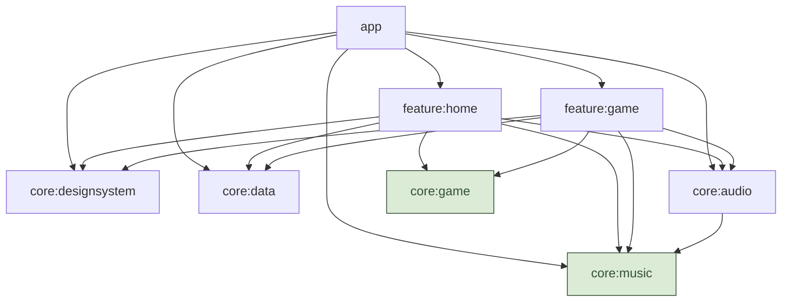
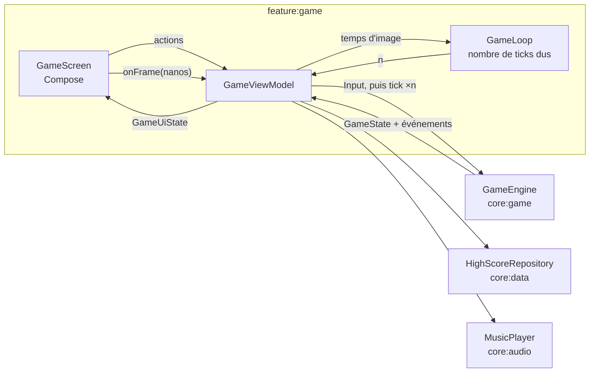

# Architecture

BloX suit les [recommandations d'architecture Android](https://developer.android.com/topic/architecture)
(couches UI, domaine, données ; flux de données unidirectionnel) et le
[guide de modularisation](https://developer.android.com/topic/modularization)
(modules `app`, `core:*`, `feature:*`, plugins de convention). La taille reste
volontairement modeste : un module n'existe que s'il porte une responsabilité claire.

## Modules

Les modules en vert sont en **Kotlin pur** (aucune dépendance Android). Le graphe montre la
cible : une flèche n'est déclarée dans Gradle que lorsque du code l'exige, car `buildHealth`
(plugin d'analyse de dépendances, tâche P0.9) refuse une dépendance sans usage.

| Module | Type | Responsabilité |
|---|---|---|
| `app` | Application Android | Point d'entrée : `MainActivity`, pile de navigation (`BloxNavDisplay`), assemblage des dépendances. |
| `feature:home` | Feature | Écran d'accueil : mode, thème, niveau de départ, musique. |
| `feature:game` | Feature | Écran de jeu, pause et fin de partie. Boucle de jeu, rendu du plateau, commandes. |
| `core:game` | Kotlin pur | **Domaine** : règles et moteur du jeu. Le cœur du projet, développé en TDD. |
| `core:music` | Kotlin pur | Modèle musical : partitions, notes, tempo. Pure donnée. |
| `core:audio` | Bibliothèque Android | Séquenceur chiptune (`AudioTrack`), lecture d'un fichier personnel. |
| `core:data` | Bibliothèque Android | Préférences et records (DataStore). |
| `core:designsystem` | Bibliothèque Compose | Thèmes BloX (jetons de couleur, typographie), composants partagés. |
| `build-logic` | Build inclus | Plugins de convention Gradle : la configuration n'est écrite qu'une fois. |

### Règles de dépendance

1. **Une feature ne dépend jamais d'une autre feature.** La navigation entre features est
   assemblée dans `app`, qui seul les connaît toutes. Chaque feature définit sa clé `NavKey` et
   expose une extension d'`EntryProviderScope` qui déclare son entrée ; `app` possède la pile et
   l'affiche avec `NavDisplay` (Navigation 3, [ADR 0011](adr/0011-navigation-3.md)).
2. **`core:game` et `core:music` ne dépendent de rien.** Ajouter une dépendance à ces modules
   demande un ADR.
3. **Le domaine ne connaît ni couleur, ni son, ni temps réel.** Un thème, un effet sonore,
   une horloge sont des détails de l'application.
4. **`core:designsystem` ne dépend pas du domaine.** L'association « type de pièce → style de
   cellule » vit dans `feature:game`.

## Couches dans une feature

Le schéma recommandé par Android, appliqué à l'écran de jeu :

- **UI (Compose)** : sans logique de jeu. Elle affiche un `GameUiState` et remonte des actions
  (`MoveLeft`, `RotateClockwise`…).
- **ViewModel** : traduit les actions en `Input` du domaine, appelle le moteur, convertit le
  `GameState` en `GameUiState`, réagit aux événements (record, musique qui accélère).
- **Domaine (`core:game`)** : joue le rôle de la couche domaine. Il n'y a pas de module
  `core:domain` séparé avec des use cases : ici le moteur *est* le domaine, et une couche de
  use cases qui ne ferait que déléguer serait de la cérémonie.
- **Données (`core:data`)** : repositories exposant des `Flow`. Un fichier DataStore par sujet,
  créé une seule fois par l'`AppContainer` avec la fabrique de `core:data` (stockage Okio,
  fichier corrompu remplacé par des préférences vides, erreur de lecture lue comme vide) : le
  record (`RECORDS_FILE`) est séparé des préférences (`SETTINGS_FILE`), pour qu'une remise à
  zéro des réglages ne le perde pas ; les deux passent par `preferencesDataStore(scope, file)`.
  Les préférences (`UserPreferencesRepository`) gardent le thème et la musique par le nom de
  leur enum (`ThemeChoice`, `MusicChoice`, propres à `core:data`), et le niveau de départ sans
  borne haute : la plage appartient au mode (`LevelProgression`), l'accueil y borne le choix.
  Une valeur inconnue ou un fichier illisible redonnent les valeurs par défaut (Original,
  Korobeïniki, niveau 0).

  **Tests :** `DataStoreHighScoreRepositoryTest`, `DataStoreUserPreferencesRepositoryTest`
  (liste des tests du record dans `docs/regles-mode-classique.md`, section « Record »).

## Boucle de jeu

Le jeu est simulé à **pas fixe** : 1 tick = 1 image = 1/60 s, comme sur la NES. L'écran
possède l'horloge d'images : un `LaunchedEffect` de `GameScreen` lance, dans
`repeatOnLifecycle(STARTED)`, `viewModel.onFramesStarted()` (qui remet `GameLoop` à zéro) puis
une boucle qui appelle `viewModel.onFrame(nanos)` à chaque image via `withFrameNanos`. Le
ViewModel délègue à une classe pure `GameLoop`, qui
accumule le temps réel écoulé et rend le nombre de ticks dus ; le ViewModel applique les entrées
puis ces ticks au moteur, dont il est le seul écrivain. Le domaine
ne connaît que les ticks, jamais les millisecondes : la vitesse ne dépend pas de la
fréquence d'écran (60, 90 ou 120 Hz). Voir les [ADR 0006](adr/0006-boucle-de-jeu-a-pas-fixe.md)
et [0012](adr/0012-horloge-d-images-cote-ecran.md).

`GameLoop` calcule en entiers (nanosecondes × 60), sans dérive. Elle plafonne le nombre de
ticks par image (4 par défaut) : sous 15 images/s, le jeu ralentit au lieu de rattraper. Une
image dont le temps recule ne donne aucun tick, et `reset()` repose la référence à la reprise.
Tests : `GameLoopTest` (`feature:game`).

Les commandes (maintien d'une flèche, répétition automatique) sont aussi comptées en ticks
dans le domaine. Ainsi le comportement du « DAS » de la NES est testable sans appareil.

## Injection de dépendances

Manuelle pour l'instant : un `AppContainer` dans `app` construit les repositories et le
lecteur de musique, et les ViewModels les reçoivent via une `ViewModelProvider.Factory`.
Hilt reste la recommandation officielle pour les projets plus gros : la migration est simple
tant que les constructeurs reçoivent leurs dépendances. Voir l'[ADR 0007](adr/0007-injection-manuelle.md).

Une feature ne voit jamais `AppContainer` : elle définit la fabrique de son ViewModel, avec ses
dépendances en paramètres, et `app` la construit puis la passe à l'entrée de navigation
(`gameEntry(onBack, viewModelFactory)`). Voir l'[ADR 0013](adr/0013-fabriques-de-viewmodel-par-les-entrees.md).

## Tests

| Où | Outils | Ce qu'on teste |
|---|---|---|
| `core:game`, `core:music` | JUnit 5, AssertJ | Toutes les règles, en TDD. Le gros de la valeur est ici. |
| Modules Android (`src/test`) | JUnit 5, AssertJ, coroutines-test, Turbine | ViewModels, repositories, rendu des échantillons audio. |
| `src/androidTest` | JUnit 5 (extensions `android-junit`), Compose UI Test | Parcours d'écrans, quand l'UI sera stable. |

JUnit 5 partout, y compris dans les modules Android grâce au plugin
`de.mannodermaus.android-junit` appliqué par les plugins de convention. Voir les
[ADR 0003](adr/0003-domaine-en-kotlin-pur.md) et [0009](adr/0009-junit5-partout.md).
